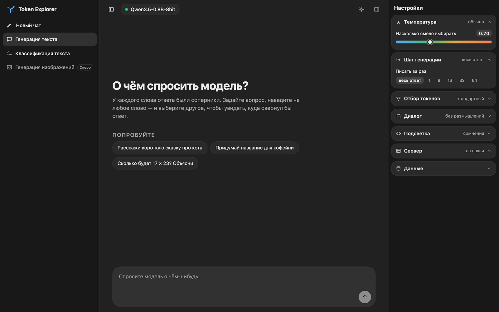

# Token Explorer

Инструмент для изучения того, как локальная языковая модель выбирает слова. Видно, из чего она выбирала каждый токен и что сделали с кандидатами фильтры, и можно пойти по другой дороге: выбрать другого кандидата, вписать свой текст или перегенерировать ответ с любого места.



Проект состоит из двух частей:

- **`server.py`** — сервер на MLX (Apple Silicon) с собственным циклом генерации. Отдаёт о каждом токене больше, чем готовые серверы, и сам раздаёт интерфейс.
- **[`ui/`](ui/README.md)** — интерфейс на React и TypeScript, собранный из компонентов своей дизайн-системы.

## Быстрый старт

Нужны Mac на Apple Silicon, Python 3.10+ и Node 20+.

Сервер:

```bash
python3 -m venv .venv
```

```bash
.venv/bin/pip install -r requirements.txt
```

Интерфейс (собирается один раз и после каждого обновления кода):

```bash
cd ui && npm install && npm run app
```

Запуск:

```bash
.venv/bin/python server.py
```

Откройте http://localhost:8090.

Модели сервер ищет в `./models` и в папке LM Studio (`~/.lmstudio/models`). Подходят папки в формате MLX: `config.json` и файлы `*.safetensors`. Скачать модель в проект:

```bash
.venv/bin/hf download mlx-community/Qwen3.5-0.8B-8bit --local-dir models/Qwen3.5-0.8B-8bit
```

Параметры запуска: `--port`, `--host`, `--model` (загрузить сразу), `--models-dir` (дополнительная папка с моделями).

## Что умеет

Слева — режимы и общая история чатов, в центре — лента, справа — настройки; обе боковые колонки скрываются кнопками в шапке. Режим называется технологией, которую разбирает: **Генерация текста** и **Классификация текста** (выбор из вариантов); **Генерация изображений** показана с плашкой «Скоро». Модель выбирается в шапке.

**Генерация текста**

- Ответ приходит по токенам; места, где модель сомневалась, подсвечены (по порогу уверенности или по энтропии).
- **Карточка токена** при наведении: вердикт, пять главных кандидатов (щелчок по любому — ветка от него) и три значка: «как выбирался токен» (то же, что щелчок по самому токену: панель с этапами отбора), «своё слово вместо этого», «заново с этого места». Те же значки есть и в шапке панели.
- **Этапы отбора**: Модель → Штраф за повторы → Top-K → Top-P → Min-P → Итог. На каждом видно, сколько токенов осталось, кто выбыл и как изменились шансы остальных (в процентных пунктах к прошлому этапу); есть объяснение простыми словами, формула с числами выбранного токена, расшифровка её букв и картинка того, что отсекает фильтр. Строка «ещё N ток.» подгружает следующие 25 кандидатов, «показать по шагам» проходит этапы по очереди.
- **Ветвление**: другой кандидат, свой текст или «заново отсюда» создают новую ветку, исходный ответ сохраняется. Ветки переключаются стрелками над ответом.
- **Шаг генерации** в настройках: сколько токенов писать за раз. Под ответом — значки «продолжить на шаг» (или Tab), «дописать до конца», «другой вариант», «копировать».
- Размышления модели сворачиваются и разбираются по токенам так же, как ответ. Служебные токены (`<|im_end|>`, `</think>`) показаны плашками; заменив такой токен, можно заставить модель продолжить.

**Классификация текста**

- Вопрос с вариантами, на который модель отвечает за один проход, без генерации текста: читается вероятность метки варианта.
- Запрос собирается в поле внизу: вопрос, метки вариантов, сами варианты (правятся на месте, перетаскиваются мышью, новый — строкой «Добавить вариант»). Инструкция, начало ответа и шаблон спрятаны за значком карандаша. Отправка — стрелкой, как в разговоре. На пустом экране — готовые вопросы-примеры; новый вопрос начинается с двух пустых вариантов.
- Карточка прогона с этапами: один токен метки → все написания метки → итог до 100%. Показано, что изменилось относительно прошлого прогона.
- Проверка устойчивости по кнопке: каждый вариант побывает на каждом месте, плюс прогон без содержания, который показывает, что притягивают сами метки.

**Общее**

- История общая для всех режимов; под названием чата — дата и время последнего запроса и число веток или прогонов. У строки при наведении появляется «⋯»: переименовать, сохранить в файл, удалить. Щелчок по режиму в левой колонке открывает в нём новый чат.
- Поле ввода растёт вместе с текстом, длинный запрос прокручивается внутри поля.
- Тёмная и светлая тема переключаются значком в шапке; по умолчанию — как в системе.
- Настройки сворачиваемыми группами: температура, шаг, отбор токенов, диалог, подсветка, сервер, данные. Всё хранится в браузере; в группе «Данные» — сохранение и загрузка файлом.

## Что отдаёт сервер

- место токена во всём словаре и энтропию по всему распределению;
- для каждого кандидата — вероятность у модели и шанс после каждого сэмплера, с указанием, какой его отсёк;
- вероятности для токенов размышлений и настоящий токен конца ответа с кандидатами;
- оценку вставленного вручную текста: каждый его токен получает вероятность;
- точное продолжение с любого места по id токенов;
- распределение следующего токена без генерации (`/score`) — на нём построена «Классификация текста».

Протоколом можно пользоваться и без интерфейса: [docs/server-protocol.md](docs/server-protocol.md).

## Ограничения

- Работает только на Apple Silicon; бэкенд для Windows и Linux пока не написан.
- Готовые серверы (LM Studio, llama.cpp) не поддерживаются: они не отдают того, на чём построены разборы. Модели, скачанные в LM Studio в формате MLX, сервер загружает сам.
- История лежит в `localStorage` браузера: лимит около 5 МБ, привязка к адресу страницы. При нехватке места интерфейс предупреждает; резервная копия — «Сохранить всё в файл».
- Большая модель, загруженная одновременно в LM Studio и в этот сервер, не помещается в 16 ГБ памяти.

## Благодарности

Token Explorer вырос из идеи [mikupad](https://github.com/lmg-anon/mikupad) — интерфейса к языковым моделям в одном HTML-файле, где можно посмотреть вероятности токенов и продолжить текст от другого варианта. Оттуда взяты главные ориентиры: работа с локальной моделью, вероятности под рукой, пошаговая генерация по Tab. Первая версия Token Explorer тоже была одним файлом; она осталась в истории репозитория. Спасибо [lmg-anon](https://github.com/lmg-anon) и всем участникам mikupad.

## Документация

- [docs/architecture.md](docs/architecture.md) — устройство интерфейса и сервера, формат данных.
- [docs/server-protocol.md](docs/server-protocol.md) — протокол сервера.
- [docs/decisions.md](docs/decisions.md) — принятые решения и их причины.
- [docs/problems-solved.md](docs/problems-solved.md) — решённые проблемы.
- [docs/roadmap.md](docs/roadmap.md) — идеи на будущее.
- [docs/lm-studio-api.md](docs/lm-studio-api.md) — как на самом деле ведут себя эндпоинты LM Studio (справка; интерфейс с ними больше не работает).
- [ui/README.md](ui/README.md) — интерфейс, компоненты и дизайн-система.
- [AGENTS.md](AGENTS.md) — правила для ИИ-агентов, работающих с кодом.
